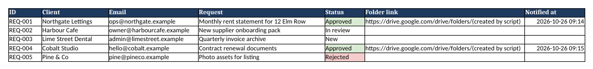
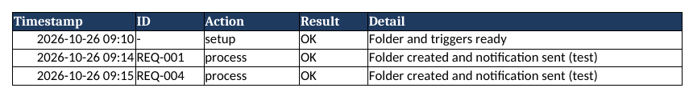
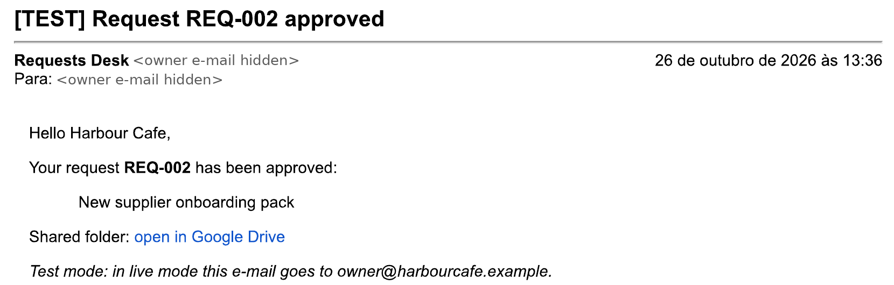
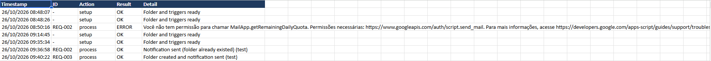
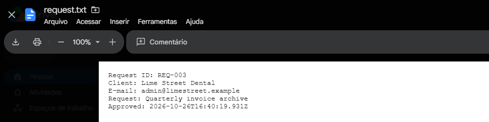

# Google Sheets → Drive → Gmail automation (Apps Script)

Approve a request in a Google Sheet and the rest happens on its own: a Drive folder is created for that client, a summary file is saved in it, an e-mail is sent, the folder link is written back to the sheet, and every run is recorded in a log tab. A daily e-mail summarises the requests by status.

> Demo data only. Every name and e-mail address in the template is fictitious.



## How it works

```
Status changed to "Approved"
  → Drive: folder "<ID> - <Client>" + request.txt
  → Sheet: folder link and "Notified at" written to the row
  → Gmail: notification (test mode: only to you)
  → Log tab: timestamp, ID, action, result
Every day at 8:00 → summary e-mail with the count per status
```

## Safety built in

- **Test mode by default.** With `NOTIFY_MODE = test`, every e-mail goes only to the owner, marked `[TEST]`. Switch to `live` in the Settings tab when you are ready.
- **No duplicates.** A row that already has a folder link is skipped, and a document lock stops two runs from processing the same row at once.
- **Visible errors.** Invalid e-mails, missing fields and quota limits are written to the Log tab instead of failing silently.
- **No passwords or API keys.** The script runs inside your own Google account with Google's standard authorisation screen.

## Sheet layout

| Tab | Purpose |
|---|---|
| Requests | ID, Client, Email, Request, Status (drop-down), Folder link, Notified at |
| Log | Timestamp, ID, Action, Result, Detail |
| Settings | PARENT_FOLDER_ID, OWNER_EMAIL, NOTIFY_MODE, SUMMARY_HOUR |



## Tested result

Run on a real Google account in test mode: the request was approved, the Drive folder was created, the notification arrived and the run was logged.

| Notification e-mail | Log tab (includes the permission error and its fix) | File saved in the new Drive folder |
|---|---|---|
|  |  |  |

## Install (about 5 minutes)

1. Upload `template/Requests_Automation_Template.xlsx` to Google Drive and open it with Google Sheets (**File > Save as Google Sheets**).
2. Open **Extensions > Apps Script**.
3. Replace the contents of `Code.gs` with [`src/Code.gs`](src/Code.gs).
4. Optional: in **Project Settings**, tick "Show appsscript.json" and paste [`src/appsscript.json`](src/appsscript.json) to pin the permissions.
5. Save, go back to the sheet and reload it. A new **Automation** menu appears.
6. Click **Automation > 1. Set up**, then review and accept Google's authorisation screen.
7. Change any row's Status to **Approved** and check the Drive folder, your inbox and the Log tab.

To remove everything: **Automation > Remove triggers**.

## Built with

Google Apps Script (V8): SpreadsheetApp, DriveApp, MailApp, ScriptApp installable triggers and LockService. No external services.

## Author

Rodrigo Matoso: real estate appraiser and broker (Brazil), building spreadsheet and automation tools with AI-assisted coding. Available for custom automations on Freelancer.com, Upwork and Workana.

## License

MIT
